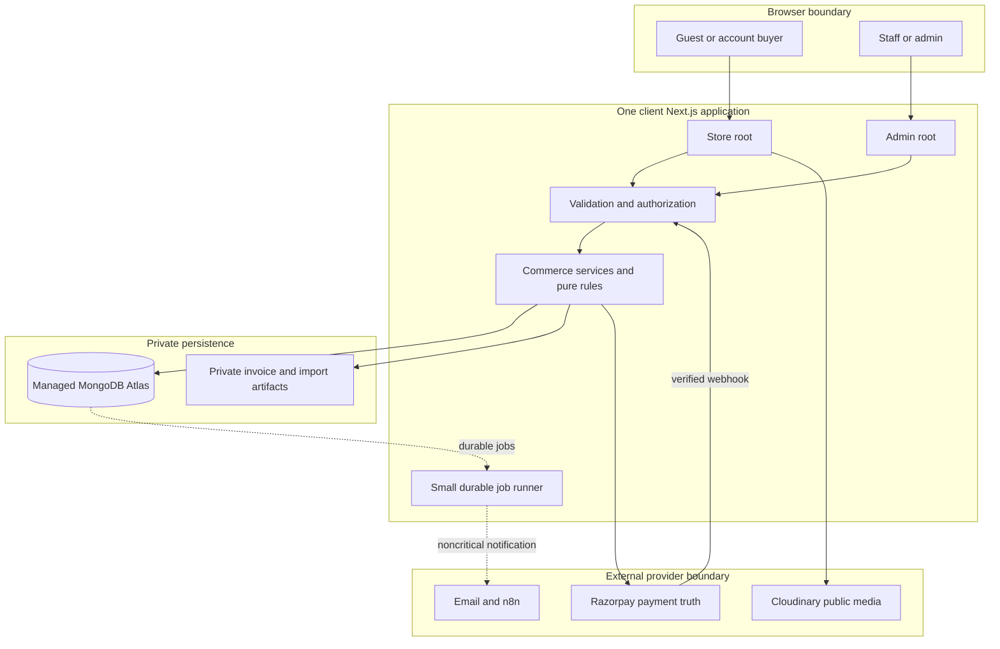
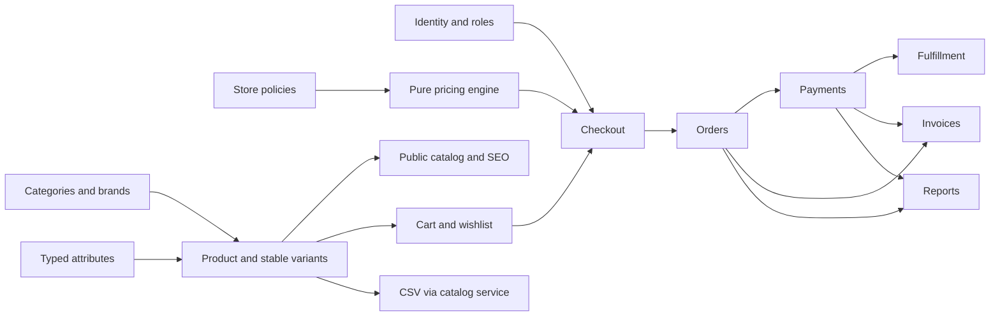
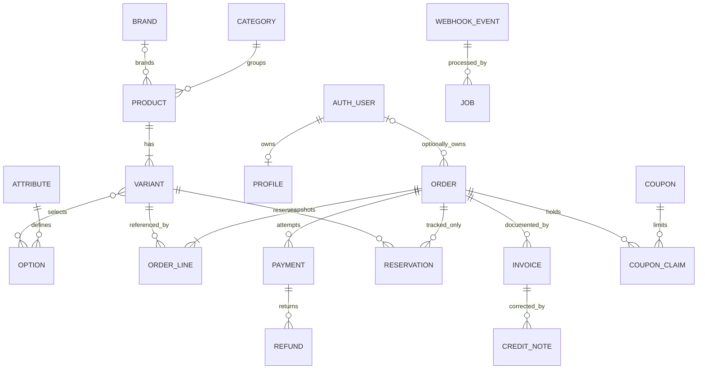
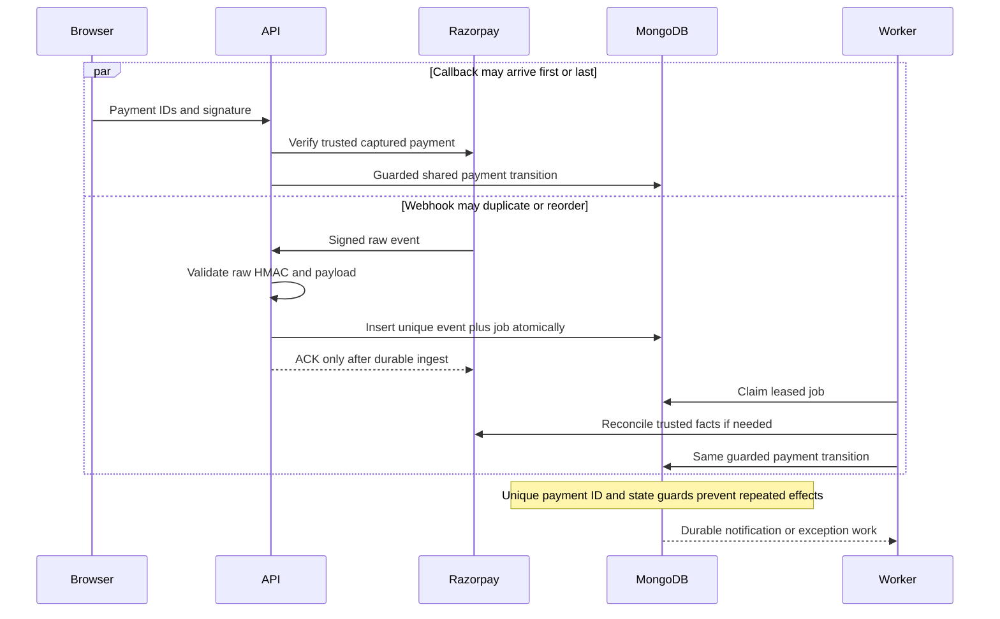
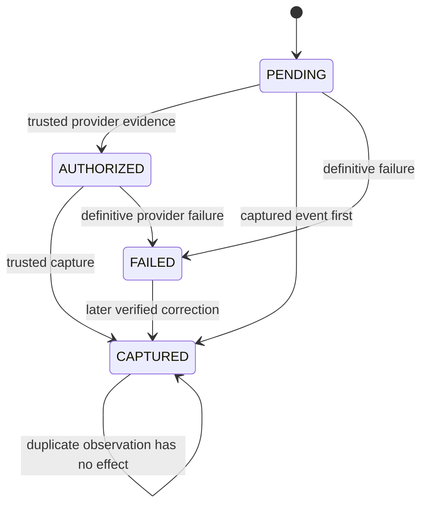
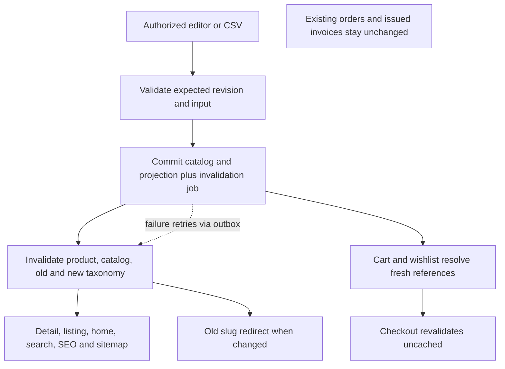
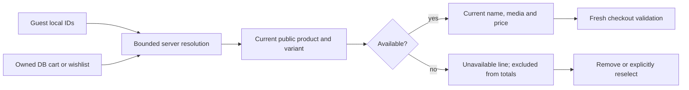
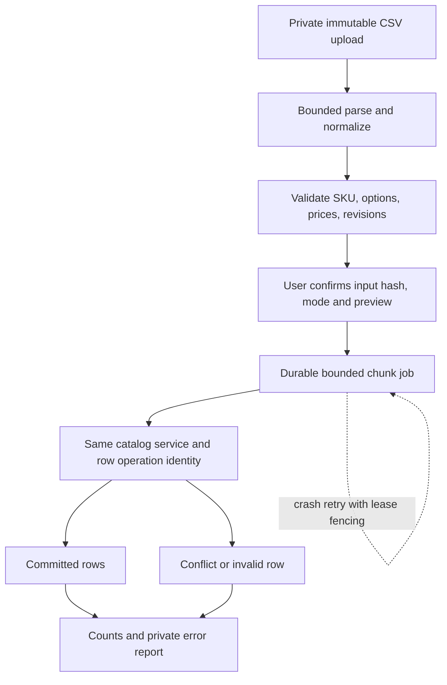
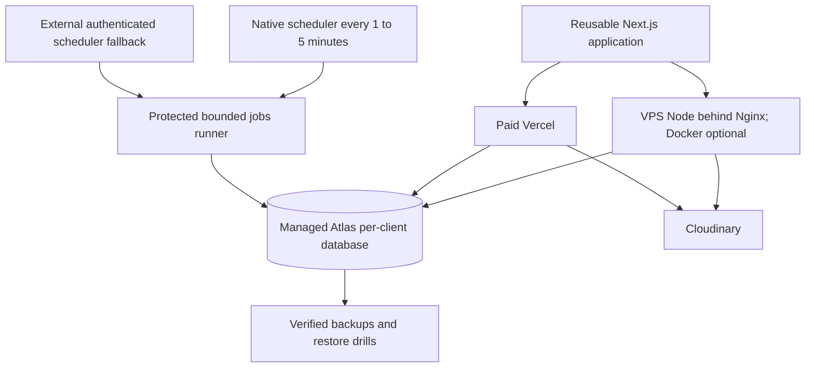

# Core architecture diagrams

These diagrams illustrate the contracts in [approved decisions](../architecture/ARCHITECTURE-DECISIONS.md) and [canonical state registry](../commerce/STATE-MACHINES.md). Dotted arrows indicate asynchronous work. Illustrative state diagrams omit some guards; the registry is authoritative.

## 1. System context and trust boundaries



## 2. Feature dependencies



## 3. Conceptual entity relationships



Order lines retain data even if the referenced catalog entity is archived. Auth user is optional for guest orders. A database relationship does not imply cascade deletion.

## 4. Checkout with optional reservations

```mermaid
sequenceDiagram
  actor Buyer
  participant App
  participant Price as Pure pricing
  participant DB as MongoDB
  participant Pay as Razorpay
  Buyer->>App: Review IDs, address, coupon
  App->>DB: Fresh validated facts
  App->>Price: Facts and policy versions
  Price-->>App: Deterministic quote
  App-->>Buyer: Review final quote
  Buyer->>App: Accept quote and idempotency key
  App->>DB: Revalidate revisions and begin transaction
  alt Quantity tracked lines
    App->>DB: Conditional reserve tracked lines
  else Status only lines
    App->>DB: Validate availability without reservations
  end
  App->>DB: Snapshot order, coupon claim, required jobs; commit
  App->>Pay: Create provider order outside DB transaction
  alt Response known
    Pay-->>App: Provider order ID
    App->>DB: Bind provider order
    App-->>Buyer: Open payment
  else Timeout after possible remote success
    App->>DB: Mark binding UNKNOWN and reconcile
    App-->>Buyer: Pending; no blind duplicate creation
  end
```

## 5. Callback and webhook convergence



## 6. Order lifecycle and late capture

```mermaid
stateDiagram-v2
  [*] --> PENDING_PAYMENT: online accepted quote
  [*] --> PLACED: accepted COD
  PENDING_PAYMENT --> PLACED: verified capture
  PENDING_PAYMENT --> EXPIRED: deadline and guarded release
  PENDING_PAYMENT --> CANCELLED: authorized cancellation
  PLACED --> CONFIRMED
  CONFIRMED --> PROCESSING
  PROCESSING --> SHIPPED: fulfillment guards pass
  SHIPPED --> DELIVERED
  PLACED --> CANCELLED
  CONFIRMED --> CANCELLED
  PROCESSING --> CANCELLED
  EXPIRED --> PLACED: late capture and atomic recovery succeeds
  EXPIRED --> EXPIRED: late capture fails recovery; refund required
  CANCELLED --> CANCELLED: late capture; refund required
```



## 7. Payment observations



Refund state and order financial summary remain separate; refund does not change CAPTURED back to FAILED.

## 8. Product mutation impact



## 9. Shopping live resolution



## 10. CSV import and resumability



## 11. Provider-neutral deployment



## Validation status

Eleven Mermaid blocks are authored with bounded standard flowchart, sequence, state and ER syntax. Structural checks and semantic review run in Stage 2. Mermaid CLI was not found in installed/bundled tooling; no package was installed. Full parser/render validation remains an explicit Stage 3 gate, not a claimed passing check.
